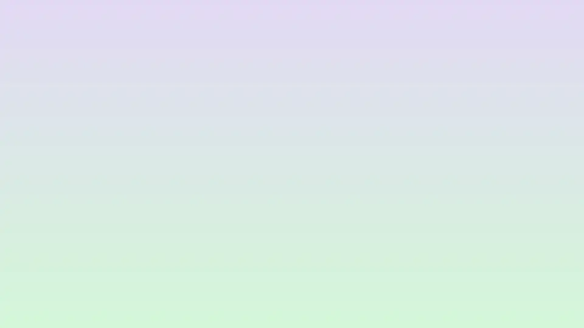
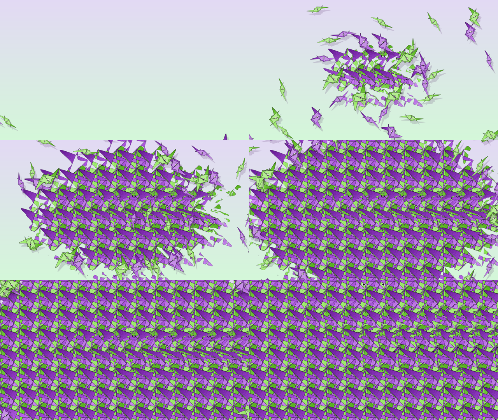
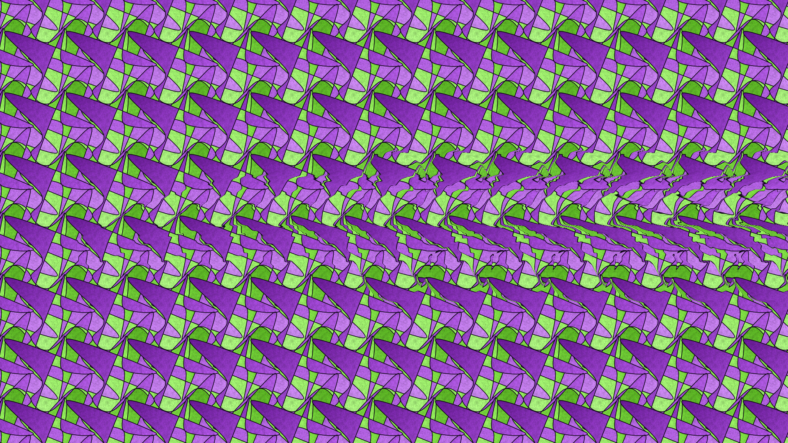
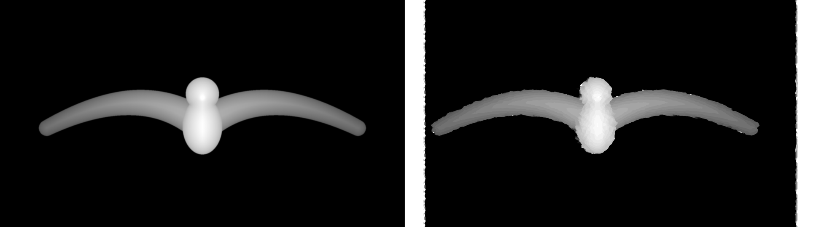
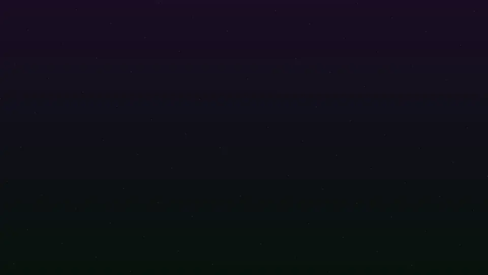
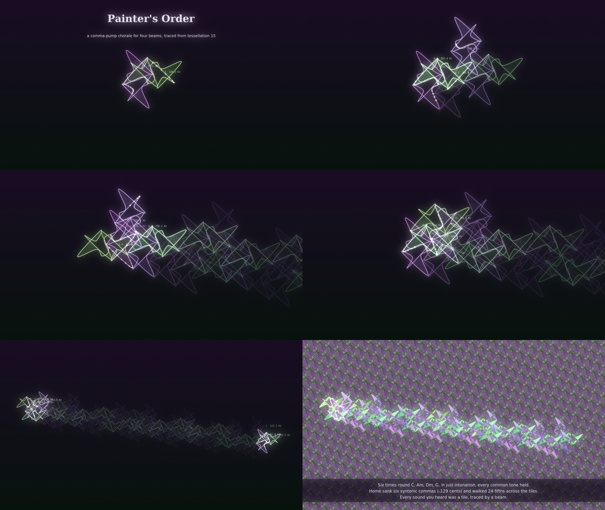
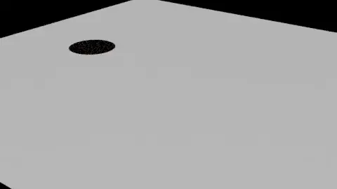
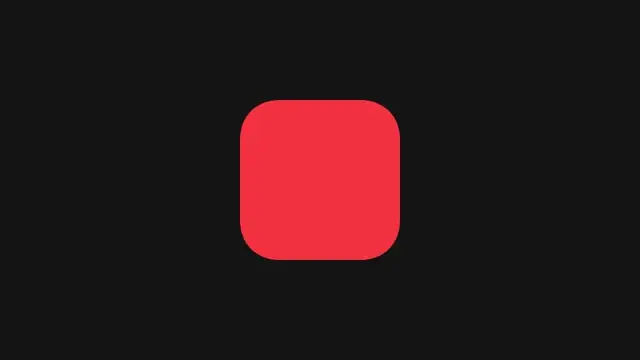
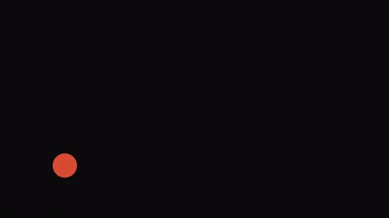
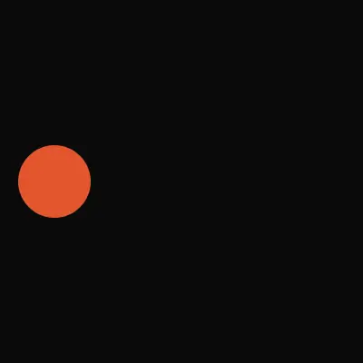

# InverseCramer

Two short films made from one source drawing, `canon/tessellation_15.svg`. Each film is rendered twice: once in a
Claude cloud container and once entirely by GitHub Actions, from the same code.

| Piece | What it is | Run locally | Run on GitHub |
|---|---|---|---|
| **Flock** | Paper swifts flutter in and land as a Magic Eye stereogram that hides a front-on gull with spread wings. Score: an original miniature in a Tchaikovsky manner (B minor, oboe, tremolo strings, harp, celesta). | `flock/run_all.sh build/flock 4` | Actions → **flock** → Run workflow |
| **Painter's Order** | A four-beam oscilloscope chorale. Each voice traces the tile outline as its waveform; the lattice is read as a just-intonation Tonnetz; a comma pump walks the music across the tiles and then fills them in. | `painters_order/run_all.sh build/painters_order 4` | Actions → **painters-order** → Run workflow |

GitHub results are committed to the `renders` branch under `gh/<piece>/`; cloud results are in `dist/cloud/<piece>/`.

**▶ Website:** https://meefs.github.io/InverseCramer/ : both films, the live Magic Eye viewer, and a playable **tile organ**
(click the lattice to hear the tile traced as sound; Space plays the comma pump). Source in `site/`, deployed by
`.github/workflows/pages.yml`; refresh it from new renders with `site/build.sh`.

## The results

### Flock: a Magic Eye made of paper swifts
[](docs/flock-720p.mp4)

▶ **[Play Flock (MP4, 42 s, with sound)](docs/flock-720p.mp4)**. The film above plays inline, full length and silent (GitHub strips video players and audio from READMEs).
Full 1080p quality: [`dist/cloud/flock/flock.mp4`](dist/cloud/flock/flock.mp4).



| Finished stereogram (view wall-eyed at 1:1 pixels) | Hidden depth vs what the decoder recovered |
|---|---|
|  |  |

- Score: original, in a Tchaikovsky manner, B minor. Lighter web encode: [`site/media/flock.mp4`](site/media/flock.mp4) (17 MB)
- Interactive viewer: [`dist/cloud/flock/flock_viewer.html`](dist/cloud/flock/flock_viewer.html). Download it and open it
  in a browser, then set the repeat slider for your screen.
- QA: the decoder recovers the gull with an edge-tolerant F-score of 0.909 (gate 0.90).

### Painter's Order: a comma-pump chorale for four beams
[](docs/painters-order-720p.mp4)

▶ **[Play Painter's Order (MP4, 58 s, with sound)](docs/painters-order-720p.mp4)**. The film above plays inline,
full length and silent. Full 1080p quality:
[`dist/cloud/painters_order/painters_order.mp4`](dist/cloud/painters_order/painters_order.mp4).



- Lighter web encode: [`site/media/painters-order.mp4`](site/media/painters-order.mp4) (14 MB)
- Every sound is the tile outline traced as an oscilloscope beam. Six rounds of C–Am–Dm–G in just intonation sink home
  by six syntonic commas (−129 cents) and walk the chorale 24 fifths across the tessellation.

### Cloud vs GitHub Actions
| | Cloud container | GitHub Actions |
|---|---|---|
| Flock, wall time | 2 min 51 s | 3 min 47 s (5 jobs in parallel) |
| Painter's Order, wall time | 6 min 24 s | 4 min 34 s (8 frame runners) |
| Outputs | [`dist/cloud/`](dist/cloud) | [`renders` branch, `gh/`](../../tree/renders/gh) |

The stereogram, the depth map and both soundtracks come out **byte-identical** on both platforms (SHA-256 in each
`checksums.txt`). The runtimes, what happened on each front and how to speed up the next run are in
**[REPORT.md](REPORT.md)**.

## Animation tooling: runnable examples
The [animation-tooling survey](docs/animation-tooling/ANIMATION_TOOLING.md) gives each tool's status and caveats. Six of
its tools have runnable files in [`docs/animation-tooling/examples/`](docs/animation-tooling/examples). The previews below
come from re-runs on 2026-10-11 in the cloud sandbox, and they match the survey's figures. They are looping WebP copies of
the renders; the full MP4s are not committed.

To run an example, `mkdir -p build/anim && cd build/anim`. `build/` is git-ignored, so virtualenvs and renders stay out of
the repo, and `../../` leads back to the root.

### Blender: a keyframed bounce (bpy)


A JSON spec becomes keyframes and a Cycles CPU render: 48 frames at 480×270, 24 fps, 2.0 s, written as PNG frames and an
H.264 MP4. The `manifest.json` it writes holds a SHA-256 of each frame's decoded pixels, so repeat runs can be compared.

```bash
python3.13 -m venv .venv && .venv/bin/pip install bpy==5.2.2
.venv/bin/python ../../docs/animation-tooling/examples/bpy/render_scene.py ../../docs/animation-tooling/examples/bpy/spec.example.json out/bounce
```

Source: [`render_scene.py`](docs/animation-tooling/examples/bpy/render_scene.py) · [`spec.example.json`](docs/animation-tooling/examples/bpy/spec.example.json)

### Manim: a dot tracing a sine curve


Manim Community 0.22.0 at `-ql` quality: 854×480, 15 fps, 67 frames (4.47 s). It needs Python 3.12, because `manimpango`
has no cp313 wheel, and on Linux the Pango and Cairo headers.

```bash
apt-get install -y libpango1.0-dev libcairo2-dev pkg-config
uv venv manim-venv --python 3.12
uv pip install --python manim-venv/bin/python manim==0.22.0
manim-venv/bin/manim -ql --format=mp4 -o sine_demo ../../docs/animation-tooling/examples/manim/sine_demo.py SineDot
```

The MP4 is written to `media/videos/sine_demo/480p15/`. Source: [`sine_demo.py`](docs/animation-tooling/examples/manim/sine_demo.py)

### Motion Canvas: a rectangle that stretches and ripples


A TypeScript scene (`src/scenes/example.tsx`). `render.mjs` drives the editor headlessly: it starts Vite, opens Motion
Canvas in Chromium, clicks Render and waits for the MP4. Output: 1280×720, 30 fps, 88 frames (2.93 s).

```bash
cp -r ../../docs/animation-tooling/examples/motion-canvas mc-demo
(cd mc-demo && npm install && CHROMIUM_PATH=/path/to/chromium node render.mjs)
```

The MP4 is `mc-demo/output/project.mp4`. Source: [`example.tsx`](docs/animation-tooling/examples/motion-canvas/src/scenes/example.tsx) · [`render.mjs`](docs/animation-tooling/examples/motion-canvas/render.mjs)

### HyperFrames: HTML and GSAP timelines


A 1920×1080 HTML page with a GSAP timeline: the title fades up over 0.8 s and the ball crosses the frame. Render:
1920×1080, 30 fps, 120 frames (4.0 s). `lint` reports 0 errors and 0 warnings. The page loads GSAP from `vendor/`, so the
vendored copy is required.

```bash
export HYPERFRAMES_CHROME_PATH=/path/to/chromium HYPERFRAMES_SKIP_SKILLS=1
npx --yes hyperframes@0.8.146 telemetry disable
npx --yes hyperframes@0.8.146 init hf-demo --example blank --non-interactive --resolution=landscape --skip-transcribe
npm install --prefix gsap-pkg gsap@3.14.2
mkdir -p hf-demo/vendor out && cp gsap-pkg/node_modules/gsap/dist/gsap.min.js hf-demo/vendor/
cp ../../docs/animation-tooling/examples/hyperframes/index.html hf-demo/index.html
npx --yes hyperframes@0.8.146 lint hf-demo
npx --yes hyperframes@0.8.146 render hf-demo -o out/hf-demo.mp4 --quiet
```

Source: [`index.html`](docs/animation-tooling/examples/hyperframes/index.html)

### Lottie: a dot sliding along a path


Hand-written Lottie JSON, 400×400, 30 fps, 60 frames (2.0 s), played by lottie-web 5.13.0. The page stops at frame 30 so
its screenshot is deterministic, which means opening it shows a still. The preview steps the playhead through all 60 frames.

```bash
mkdir -p lottie-demo/vendor
npm install --prefix lottie-demo lottie-web@5.13.0
cp lottie-demo/node_modules/lottie-web/build/player/lottie.min.js lottie-demo/vendor/
cp ../../docs/animation-tooling/examples/lottie/index.html lottie-demo/
```

Then open `lottie-demo/index.html` in a browser. Source: [`index.html`](docs/animation-tooling/examples/lottie/index.html)

### MediaPipe: pose landmarks on a still photo


MediaPipe Pose Landmarker (mediapipe 1.1.0) finds one pose in scikit-image's sample photo and draws its 33 landmarks into
`pose_overlay.png`. The model is a 5.8 MB `.task` file that the script loads from the current directory.

```bash
uv venv mp-venv --python 3.12
uv pip install --python mp-venv/bin/python mediapipe scikit-image pillow
apt-get install -y libegl1 libgl1 libgles2
curl -sSL -o pose_landmarker_lite.task https://storage.googleapis.com/mediapipe-models/pose_landmarker/pose_landmarker_lite/float16/latest/pose_landmarker_lite.task
mp-venv/bin/python ../../docs/animation-tooling/examples/mediapipe/pose_check.py
```

Source: [`pose_check.py`](docs/animation-tooling/examples/mediapipe/pose_check.py)

Remotion (React video) and Rhubarb Lip Sync also have verified commands in the survey (§5.5 and §5.8), but no files under
`examples/`, so they have no preview here.

## Skill: make your own Painter's Order
The Painter's Order pipeline is packaged as a Claude skill in [`.claude/skills/painters-order/`](.claude/skills/painters-order)
(installable bundle: [`dist/painters-order.skill`](dist/painters-order.skill)). Give it any tessellation SVG that is
one prototile repeated with `matrix(...)` transforms. It works out the orientation classes and lattice and prints the
tile's harmonic spectrum, then renders the oscilloscope chorale and the browser tile organ:

```bash
PO_PREVIEW=1 .claude/skills/painters-order/scripts/run.sh canon/tessellation_15.svg build/po   # ~30 s preview
PO_TITLE="My Walk" .claude/skills/painters-order/scripts/run.sh my-tiling.svg build/po         # full film
```
It was tested on tessellation 15 (four rotations, square lattice; reproduces this repo's soundtrack byte for byte), a
three-rotation hexagonal tiling, and a two-class tiling whose copies don't share a pivot.

## What the SVG turned out to be
- One prototile (16 cubic Béziers) placed 964 times, in four 90° rotations, one colour each, sharing a pivot (wallpaper group p4).
- A square lattice of 83.07 px, tilted 22°.
- The outline **crosses itself**, so neighbouring tiles overlap and the *draw order* decides what is visible. The SVG is
  drawn outward from the centre, which is why the screen capture shows four different-looking regions. Painting in a
  translation-invariant order (colour class, then position along a fixed direction) gives a truly periodic pattern.
- Traced as a waveform, the outline has 180° point symmetry, so it contains **only odd harmonics** (clarinet-like),
  and nothing above the 11th.

## Layout
```
canon/            the source SVG
refs/             the brief documents and the screen capture
common/tess.py    geometry read from the SVG (lattice, classes, Bézier trace)
common/synth.py   NumPy orchestra and hall reverb (no samples)
flock/            pattern cell, gull depth, stereogram + QA decoder, fly-in, score, viewer
painters_order/   Tonnetz comma pump, scope audio, glowing-beam film
docs/animation-tooling/  the tool survey, runnable examples and their previews
.github/          setup + publish composite actions, one workflow per piece
```

## Requirements
Python 3.11+ with `pip install -r requirements.txt`, plus ffmpeg, the Cairo library and DejaVu fonts
(`apt-get install ffmpeg libcairo2 fonts-dejavu-core`; on macOS `brew install ffmpeg cairo`).

## QA
`flock.still` decodes its own stereogram (per-row block matching) and compares the recovered depth with the gull.
It exits non-zero below an edge-tolerant F-score of 0.90, which fails the GitHub job before any frames render.
